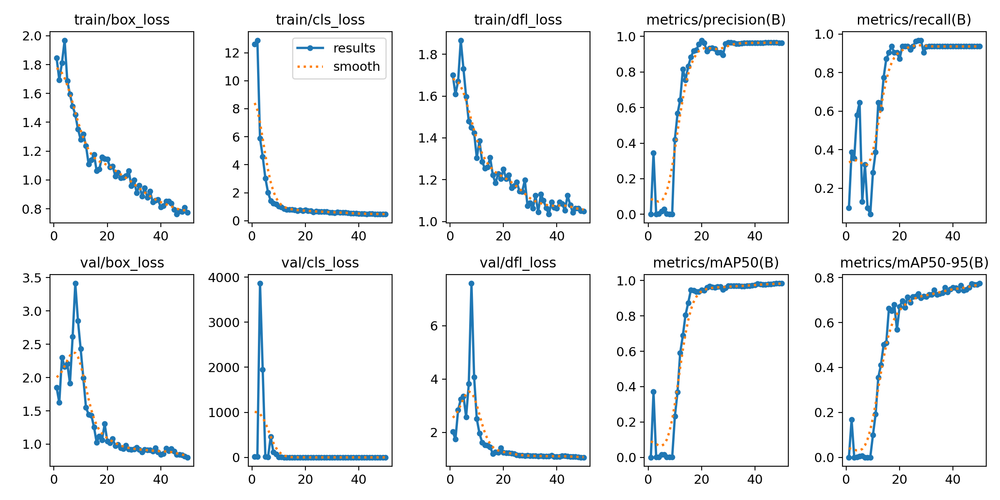
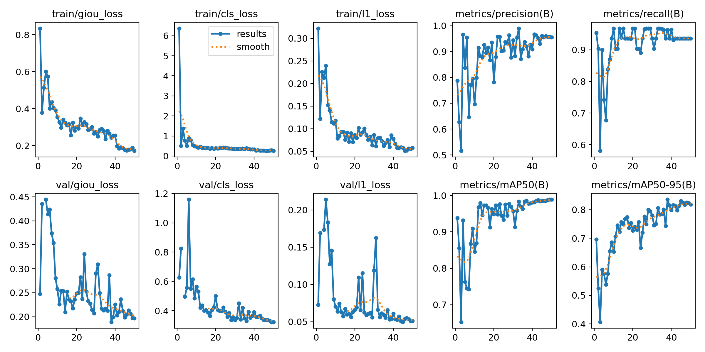
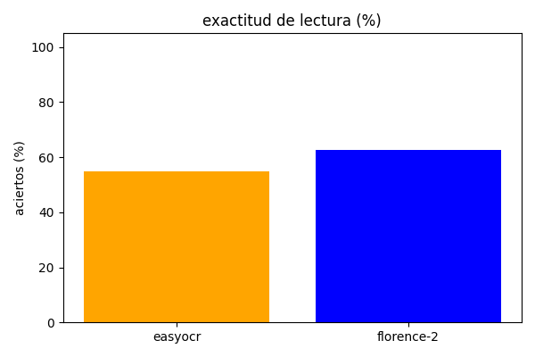
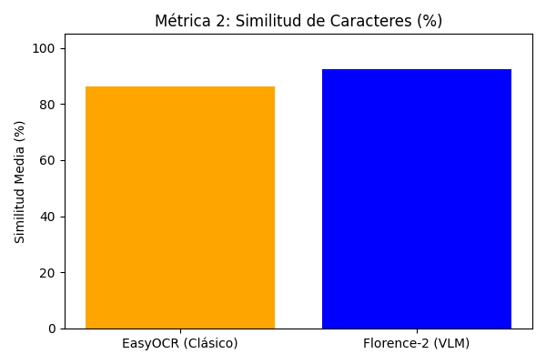
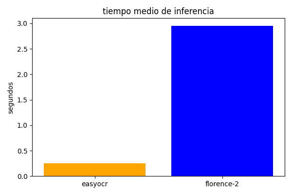
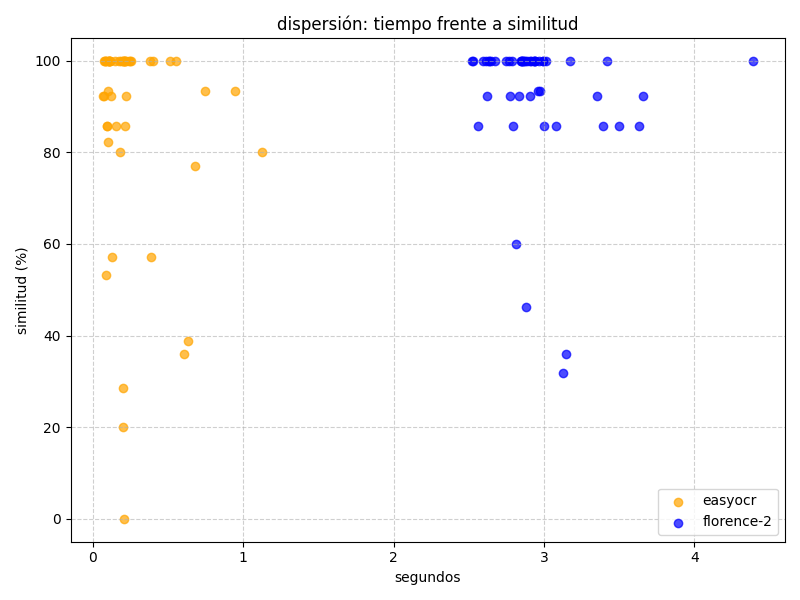
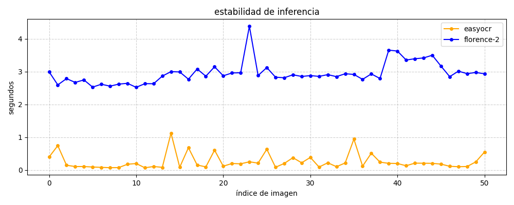

# Práctica 4 VC

Ejercicios de la cuarta práctica de laboratorio de VC.

Nicolás Hernández Castro y Gabriel Godoy Navarro - EII ULPGC 13 de noviembre de 2026


## Entrenamiento

El conjunto de imagenes de vehículos que se utilizó en esta práctica se puede ver en el siguiente enlace: https://drive.google.com/drive/folders/1si7ISib-EFdn_7kkbebNzmaCSSybdQJM?usp=drive_link

Las imágenes se distribuyen de la siguiente manera:
* Entrenamiento: 151 imagenes (72%)
* Validación: 28 imagenes (13%)
* Test: 31 imágenes (15%)

Dado que los pesos preentrenados del conjunto COCO no contemplan la categoría de matrícula de vehículos, se procedió al entrenamiento supervisado de un detector especializado utilizando **YOLO** (en concreto la versión ligera `yolo11n.pt`). El proceso se llevó a cabo en Google Colab con GPU NVIDIA Tesla T4 (16 GB VRAM), empleando el dataset mostrado anteriormente con la siguiente configuración:

```python
from ultralytics import YOLO

model = YOLO('yolo11n.pt')
results = model.train(
    data='/content/matriculas.yaml',
    epochs=50,
    imgsz=640,
    batch=16,
    device=0
)
```




Al observar las gráficas de resultado a lo largo de las 50 épocas de entrenamiento:

* Evolución de los errores (pérdidas): Los fallos al situar las cajas (box_loss y dfl_loss) van bajando de forma suave y constante, pasando de valores iniciales cercanos a 1.8 hasta estabilizarse en torno a 0.8 tanto en entrenamiento como en validación. Por su parte, el error al reconocer la clase (cls_loss) cae en picado a partir de la época 8 por debajo de 0.4, lo que demuestra que la red aprende rápido y sin problemas de memorización o sobreajuste (overfitting).

* Precisión y aciertos: La precisión y la capacidad para detectar todas las placas sin dejarse ninguna (recall) suben con mucha fuerza entre las épocas 10 y 18, consolidándose en valores muy altos, superiores al 90%.

* Rendimiento global ($mAP$): El porcentaje de acierto general ($mAP_{50}$) sube enseguida hasta situarse en un valor superior al  90%. A su vez, la métrica más exigente ($mAP_{50-95}$), que mide si la caja está milimétricamente ajustada a los bordes de la matrícula, progresa poco a poco hasta casi el 80%, confirmando que el modelo encuadra las placas con gran exactitud.

### Apartado Extra: Evaluación comparativa YOLO vs. RT-DETR
Como ampliación, se evalúa una alternativa moderna basada en Transformers (RT-DTER). 

Para llevar a cabo el experimento en igualdad de condiciones, se entrenó rtdetr-l.pt sobre el mismo conjunto de datos durante 50 épocas a resolución 640. Debido a la alta demanda de memoria de las matrices de atención del Transformer, fue necesario ajustar el tamaño de lote a batch=4 (frente a batch=16 de YOLO) para no desbordar los 16 GB de VRAM de la GPU T4:

```python
from ultralytics import RTDETR

model = RTDETR('rtdetr-l.pt')
results = model.train(
    data='/content/matriculas.yaml',
    epochs=50,
    imgsz=640,
    batch=4,
    device=0,
    name='rtdetr_matriculas'
)
```



Al comparar las gráficas de resultado de RT-DETR frente a las de YOLO:
* Evolución de pérdidas y convergencia: Al igual que en YOLO, las pérdidas de RT-DETR (giou_loss, cls_loss y l1_loss) caen de forma constante sin indicios de sobreajuste. Presenta algo más de oscilación en las primeras épocas de validación debido al ajuste de las capas de atención del Transformer, pero a partir de la época 20 se estabiliza con valores mínimos.

* Precisión y detección: Tanto la precisión como el recall crecen de forma rápida y pareja a YOLO, consolidándose ambas métricas en valores muy altos, sobre el 95% en precisión y superiores al 90% en capacidad de detección.

* Rendimiento de localización ($mAP$): En la detección estándar ($mAP_{50}$), ambos modelos muestran un comportamiento casi idéntico, saturando con rapidez en valores superiores al 95%. La diferencia principal aparece en la métrica estricta ($mAP_{50-95}$): mientras que YOLO se queda rondando el 80%, RT-DETR supera claramente el 80%, logrando delimitar las esquinas y proporciones de la matrícula con una fidelidad geométrica ligeramente superior. 

Además, destacar que el entrenamiento con YOLO fue notablemente más rápido (0.072 horas) que con RT-DETR (0.274 horas).

## Detección, seguimiento y lectura de matrículas en vídeo

En primer lugar, se crea dinámicamente el archivo `bytetrack_rapido.yaml`. En lugar de los 30 fotogramas habituales, se ajusta el búfer a `track_buffer: 8` para que, cuando un vehículo salga del encuadre, su caja delimitadora se destruya en apenas 0.25 segundos y no quede flotando en los bordes.   

Además, se define el selector booleano `USAR_RTDETR` para conmutar fácilmente entre el modelo convolucional `best.pt` y el Transformer `best_rtdetr.pt`, asignando nombres dinámicos a las salidas para que no se sobreescriban entre ejecuciones:

```python
USAR_RTDETR = False

TRACKER_CFG = 'bytetrack_rapido.yaml'
with open(TRACKER_CFG, 'w') as f:
    f.write("""
tracker_type: bytetrack
track_high_thresh: 0.35
track_low_thresh: 0.1
new_track_thresh: 0.4
track_buffer: 8
match_thresh: 0.8
fuse_score: True
""".strip())

VIDEO_ENTRADA = 'C0142.MP4'

SUFIJO_MODELO = '_rtdetr' if USAR_RTDETR else '_yolo'
VIDEO_SALIDA = f'resultado_C0142{SUFIJO_MODELO}.mp4'
CSV_SALIDA = f'detecciones_seguimiento{SUFIJO_MODELO}.csv'

MODELO_GENERAL_PATH = 'yolo11n.pt'
MODELO_MATRICULAS_PATH = 'best_rtdetr.pt' if USAR_RTDETR else 'best.pt'

CLASES_INTERES = [0, 2, 3, 5, 7]
CLASES_VEHICULOS = [2, 3, 5, 7]

DISPOSITIVO = 0 if torch.cuda.is_available() else 'cpu'

modelo_general = YOLO(MODELO_GENERAL_PATH)

if USAR_RTDETR:
    modelo_matriculas = RTDETR(MODELO_MATRICULAS_PATH)
else:
    modelo_matriculas = YOLO(MODELO_MATRICULAS_PATH)

reader_ocr = easyocr.Reader(['es', 'en'], gpu=torch.cuda.is_available())
```

Luego, se extraen las propiedades del vídeo de entrada (dimensiones y FPS) con `cv2.VideoCapture` y se configura el objeto `cv2.VideoWriter` con el códec `mp4v`. A la par, se inicializa el archivo CSV escribiendo la cabecera con las 15 columnas exigidas para almacenar fotograma, clases, coordenadas y texto:

```python
cap = cv2.VideoCapture(VIDEO_ENTRADA)
if not cap.isOpened():
    raise FileNotFoundError(f"No se pudo abrir el video: {VIDEO_ENTRADA}")

ancho = int(cap.get(cv2.CAP_PROP_FRAME_WIDTH))
alto = int(cap.get(cv2.CAP_PROP_FRAME_HEIGHT))
fps = cap.get(cv2.CAP_PROP_FPS)
fps_salida = fps if fps > 0 else 25.0
total_frames = int(cap.get(cv2.CAP_PROP_FRAME_COUNT))

out = cv2.VideoWriter(
    VIDEO_SALIDA,
    cv2.VideoWriter_fourcc(*'mp4v'),
    fps_salida,
    (ancho, alto)
)

f_csv = open(CSV_SALIDA, mode='w', newline='', encoding='utf-8')
csv_writer = csv.writer(f_csv)

csv_writer.writerow([
    'fotograma', 'tipo_objeto', 'confianza', 'identificador_tracking',
    'x1', 'y1', 'x2', 'y2',
    'matricula_en_su_caso', 'confianza_matricula',
    'mx1', 'my1', 'mx2', 'my2', 'texto_matricula'
])
```

Para evitar contar vehículos duplicados por parpadeos o vehículos estacionados, se fijan umbrales de tiempo y movimiento. Se definen diccionarios y conjuntos para registrar el historial de desplazamiento, la votación de categorías y una memoria temporal para no reejecutar el detector de matrículas fotograma a fotograma:

```python
MIN_FRAMES_VALIDO = 10
MIN_DESPLAZAMIENTO = 40

historial_tracks = defaultdict(lambda: {
    'inicio': None,
    'actual': None,
    'frames': 0,
    'clases': defaultdict(int)
})

conteo_unicos = {
    'person': set(),
    'car': set(),
    'motorcycle': set(),
    'bus': set(),
    'truck': set()
}

cache_matriculas = {}

COLORES = {
    'person': (255, 105, 65),
    'car': (40, 200, 40),
    'motorcycle': (0, 165, 255),
    'bus': (200, 200, 0),
    'truck': (180, 0, 180),
    'matricula': (0, 255, 255)
}
````

El vídeo se recorre fotograma a fotograma bajo `torch.no_grad()` para ahorrar memoria y acelerar la inferencia. En cada cuadro se ejecuta `modelo_general.track(..., persist=True)` para detectar objetos y mantener su identificador temporal, extrayendo sus coordenadas y descartando cajas menores a $25 \times 25$ píxeles situadas al fondo para evitar falsos positivos:

```python
with torch.no_grad():
    while cap.isOpened():
        ret, frame = cap.read()
        if not ret:
            break
        frame_idx += 1

        resultados_track = modelo_general.track(
            source=frame,
            persist=True,
            classes=CLASES_INTERES,
            tracker=TRACKER_CFG,
            conf=0.35,
            imgsz=640,
            device=DISPOSITIVO,
            verbose=False
        )

        if resultados_track and len(resultados_track) > 0 and resultados_track[0].boxes is not None:
            cajas = resultados_track[0].boxes

            for box in cajas:
                x1, y1, x2, y2 = map(int, box.xyxy[0].tolist())
                confianza = float(box.conf[0])
                clase_id = int(box.cls[0])
                nombre_clase = modelo_general.names[clase_id]
                track_id = int(box.id[0]) if box.id is not None else -1

                w_box = x2 - x1
                h_box = y2 - y1
                if w_box < 25 or h_box < 25:
                    continue

                cx = int((x1 + x2) / 2)
                cy = int((y1 + y2) / 2)
```

Para cada identificador activo se acumulan los fotogramas en los que aparece y se elige su categoría definitiva por votación mayoritaria `max`, evitando cambios bruscos de etiqueta entre cuadros. Cuando un objeto ha sido visto durante 10 fotogramas y se ha desplazado `math.hypot` al menos 40 píxeles desde su origen (20 en personas), se registra en su conjunto correspondiente de `conteo_unicos` tras descartarlo de las demás clases:

```python
                clase_dominante = nombre_clase
                if track_id != -1:
                    t = historial_tracks[track_id]
                    t['frames'] += 1
                    t['clases'][nombre_clase] += 1
                    if t['inicio'] is None:
                        t['inicio'] = (cx, cy)
                    t['actual'] = (cx, cy)

                    clase_dominante = max(t['clases'].items(), key=lambda x: x[1])[0]

                    if t['frames'] >= MIN_FRAMES_VALIDO:
                        disp = math.hypot(t['actual'][0] - t['inicio'][0], t['actual'][1] - t['inicio'][1])
                        es_vehiculo = clase_id in CLASES_VEHICULOS
                       
                        if (not es_vehiculo and disp >= 20) or (es_vehiculo and disp >= MIN_DESPLAZAMIENTO):
                            for c in conteo_unicos:
                                conteo_unicos[c].discard(track_id)
                            if clase_dominante in conteo_unicos:
                                conteo_unicos[clase_dominante].add(track_id)
```

Para optimizar el rendimiento, la búsqueda de matrículas se limita a vehículos de tamaño suficiente (mayor a 50 x 50 píxeles) que no estén tocando los bordes laterales `not esta_saliendo`. Si la matrícula ya se ubicó en los últimos 4 fotogramas, se proyecta su nueva posición utilizando las coordenadas relativas guardadas en caché `rel_coords`. Cuando toca volver a detectarla, se recorta la región del vehículo `roi_vehiculo`, se trasladan las coordenadas de la matrícula al fotograma completo, se amplía el recorte y se extraen los caracteres alfanuméricos con `EasyOCR`:

```python
caja_matricula = None
                conf_matricula = None
                texto_matricula = ""

                if clase_id in CLASES_VEHICULOS:
                    vx1, vy1 = max(0, x1), max(0, y1)
                    vx2, vy2 = min(ancho, x2), min(alto, y2)
                    w_veh = vx2 - vx1
                    h_veh = vy2 - vy1

                    # Ignorar vehículos que ya estén cortados saliendo de la pantalla
                    esta_saliendo = (vx1 <= 15) or (vx2 >= ancho - 15)

                    if w_veh > 50 and h_veh > 50 and not esta_saliendo:
                        usar_detector = True

                        if track_id != -1 and track_id in cache_matriculas:
                            frames_pasados = frame_idx - cache_matriculas[track_id]['frame']
                            if frames_pasados <= 4:
                                rx1, ry1, rx2, ry2 = cache_matriculas[track_id]['rel_coords']
                                gx1 = int(vx1 + rx1 * w_veh)
                                gy1 = int(vy1 + ry1 * h_veh)
                                gx2 = int(vx1 + rx2 * w_veh)
                                gy2 = int(vy1 + ry2 * h_veh)
                                caja_matricula = (gx1, gy1, gx2, gy2)
                               
                                conf_matricula = cache_matriculas[track_id].get('conf', 0.0)
                                texto_matricula = cache_matriculas[track_id].get('texto', "")
                                usar_detector = False

                        if usar_detector:
                            roi_vehiculo = frame[vy1:vy2, vx1:vx2]
                            res_placas = modelo_matriculas(
                                roi_vehiculo,
                                imgsz=320,
                                conf=0.35,
                                device=DISPOSITIVO,
                                verbose=False
                            )

                            if res_placas and len(res_placas) > 0 and len(res_placas[0].boxes) > 0:
                                mejor_placa = res_placas[0].boxes[0]
                                px1_r, py1_r, px2_r, py2_r = map(int, mejor_placa.xyxy[0].tolist())
                               
                                gx1 = vx1 + px1_r
                                gy1 = vy1 + py1_r
                                gx2 = vx1 + px2_r
                                gy2 = vy1 + py2_r
                                caja_matricula = (gx1, gy1, gx2, gy2)
                                conf_matricula = float(mejor_placa.conf[0])

                                img_placa = frame[gy1:gy2, gx1:gx2]
                                if img_placa.shape[0] > 10 and img_placa.shape[1] > 20:
                                   
                                    img_ampliada = cv2.resize(img_placa, None, fx=2.5, fy=2.5, interpolation=cv2.INTER_CUBIC)
                                    img_gris = cv2.cvtColor(img_ampliada, cv2.COLOR_BGR2GRAY)

                                    resultados_ocr = reader_ocr.readtext(img_gris, detail=0, paragraph=True)
                                   
                                    if resultados_ocr:
                                        texto_crudo = "".join(resultados_ocr).upper()
                                        texto_limpio = "".join(filter(str.isalnum, texto_crudo))
                                       
                                        if len(texto_limpio) >= 4:
                                            texto_matricula = texto_limpio

                                if track_id != -1:
                                    cache_matriculas[track_id] = {
                                        'rel_coords': (px1_r / w_veh, py1_r / h_veh, px2_r / w_veh, py2_r / h_veh),
                                        'frame': frame_idx,
                                        'conf': conf_matricula,
                                        'texto': texto_matricula
                                    }
                    else:
                        if track_id != -1:
                            cache_matriculas.pop(track_id, None)
```

Al finalizar cada fotograma, se registran las coordenadas y datos en el CSV. Luego se dibujan las cajas con su color correspondiente para cada clase, el recuadro amarillo para la matrícula y un panel HUD en la esquina superior izquierda con el contador acumulado de cada tipo de objetos:

```python

                tiene_mat = "Si" if caja_matricula is not None else "No"
                conf_mat_str = f"{conf_matricula:.2f}" if caja_matricula is not None and conf_matricula is not None else ""
                mx1, my1, mx2, my2 = caja_matricula if caja_matricula is not None else ("", "", "", "")

                csv_writer.writerow([
                    frame_idx, clase_dominante, f"{confianza:.2f}", track_id,
                    x1, y1, x2, y2, tiene_mat, conf_mat_str,
                    mx1, my1, mx2, my2, texto_matricula
                ])

                color_obj = COLORES.get(clase_dominante, (0, 255, 0))
                cv2.rectangle(frame, (x1, y1), (x2, y2), color_obj, 2)
                cv2.putText(
                    frame,
                    f"ID:{track_id} {clase_dominante}",
                    (x1, max(20, y1 - 8)),
                    cv2.FONT_HERSHEY_SIMPLEX, 0.5, color_obj, 2
                )

                if caja_matricula is not None:
                    cv2.rectangle(frame, (mx1, my1), (mx2, my2), COLORES['matricula'], 2)
                    etiqueta_placa = f"{texto_matricula} ({conf_mat_str})" if texto_matricula else "Matricula"
                    cv2.putText(
                        frame, etiqueta_placa,
                        (mx1, max(15, my1 - 5)),
                        cv2.FONT_HERSHEY_SIMPLEX, 0.45, COLORES['matricula'], 2
                    )

        cv2.rectangle(frame, (15, 15), (270, 160), (0, 0, 0), -1)
        cv2.rectangle(frame, (15, 15), (270, 160), (255, 255, 255), 1)
        cv2.putText(frame, f"Frame: {frame_idx}/{total_frames}", (25, 38), cv2.FONT_HERSHEY_SIMPLEX, 0.52, (255, 255, 255), 1)

        y_offset = 62
        for clase, ids in conteo_unicos.items():
            color_txt = COLORES.get(clase, (200, 200, 200))
            cv2.putText(frame, f"Total {clase}s: {len(ids)}", (25, y_offset), cv2.FONT_HERSHEY_SIMPLEX, 0.5, color_txt, 1)
            y_offset += 22

        out.write(frame)
        if frame_idx % 50 == 0 or frame_idx == total_frames:
            print(f"Progreso: {frame_idx}/{total_frames} fotogramas procesados...")

cap.release()
out.release()
f_csv.close()
```

Video resultado procesado con YOLO: https://www.youtube.com/watch?v=VU8vAfFiS4U

Video resultado procesado con RT-DETR: https://www.youtube.com/watch?v=x1TQoax1NNQ

## Evaluación comparativa entre modelos orientados al reconocimiento de texto (EasyOCR vs. Florence-2)

En esta segunda tarea, el objetivo es comparar dos formas distintas de leer matrículas sobre un conjunto de imágenes de prueba (`./fotos_prueba`) donde el nombre de cada archivo corresponde a su matrícula real:

* **OCR tradicional (EasyOCR):** Funciona en dos pasos separados: primero busca dónde están las letras (CRAFT) y luego las lee una por una (CRNN).
* **Modelo de Visión y Lenguaje (Florence-2):** Es una inteligencia artificial más moderna (`microsoft/Florence-2-base`) que mira la imagen completa y entiende el texto directamente al pedirle la orden `<OCR>`.

Debido a que Florence-2 es una red pesada para ejecutarse en procesador sin tarjeta gráfica dedicada, se decidió hacer esta comparativa sobre una batería de imágenes estáticas de vehículos en lugar de analizar el vídeo completo fotograma a fotograma.

### Preparación del entorno y carga de modelos

Primero se importan las librerías necesarias y se añade un pequeño parche para simular el paquete `flash_attn`. Esto evita que el programa dé error al cargar Florence-2 en Windows o cuando se usa solo CPU.

Después se define la función `calculate_similarity`, que mide del 0% al 100% cuánto se parece el texto leído a la matrícula real. Esto es importante porque medir solo el acierto exacto es demasiado estricto: si un modelo lee `1159FPG` como `159FPG`, el acierto exacto sería 0%, pero la similitud refleja que ha acertado casi toda la matrícula.

Por último, se definen las rutas (`./fotos_prueba` y `resultados_comparativa.csv`), las clases de vehículos en YOLO (`[2, 3, 5, 7]` para coches, motos, guaguas y camiones) y se cargan todos los modelos en memoria una sola vez antes de empezar el bucle:

```python
import sys
import types
import importlib.machinery
import os
import time
import cv2
import pandas as pd
import matplotlib.pyplot as plt
import torch
import easyocr
import difflib
from transformers import AutoProcessor, AutoModelForCausalLM
from PIL import Image
from ultralytics import YOLO

# Parche para dependencias en Windows
dummy_flash = types.ModuleType('flash_attn')
dummy_flash.__spec__ = importlib.machinery.ModuleSpec('flash_attn', None)
sys.modules['flash_attn'] = dummy_flash
sys.modules['flash_attn.bert_padding'] = dummy_flash

def calculate_similarity(read_text, true_text):
    if not read_text or not true_text:
        return 0.0
    return difflib.SequenceMatcher(None, read_text, true_text).ratio() * 100

image_folder = "./fotos_prueba"
csv_output = "resultados_comparativa.csv"
vehicle_classes = [2, 3, 5, 7]

vehicle_model = YOLO('yolo11n.pt')
plate_model = YOLO('best.pt')

use_gpu = torch.cuda.is_available()
ocr_reader = easyocr.Reader(['es', 'en'], gpu=use_gpu)

device = "cuda:0" if use_gpu else "cpu"
tensor_dtype = torch.float16 if use_gpu else torch.float32
vlm_processor = AutoProcessor.from_pretrained("microsoft/Florence-2-base", trust_remote_code=True)
vlm_model = AutoModelForCausalLM.from_pretrained("microsoft/Florence-2-base", torch_dtype=tensor_dtype, trust_remote_code=True).to(device)
```

### Detección, recorte y lectura de matrículas

Se recorre la carpeta `./fotos_prueba` imagen por imagen, extrayendo la matrícula real directamente del nombre del archivo. Para cada foto se sigue este proceso:

* **Detección en dos pasos:** Primero `yolo11n.pt` localiza el vehículo y lo recorta; después `best.pt` busca la matrícula únicamente dentro de ese recorte para evitar falsos positivos en el fondo.
* **Margen de seguridad:** Al recortar la matrícula se añaden 5 píxeles extra por cada lado, ya que los algoritmos de lectura necesitan un pequeño espacio alrededor de las letras para reconocer bien sus bordes.
* **Lectura en igualdad de condiciones:** Ambos reciben exactamente el mismo recorte de píxeles, midiendo el tiempo que tarda cada uno con `time.time()`. EasyOCR recibe la imagen en blanco y negro, mientras que Florence-2 la recibe a color junto a la instrucción `<OCR>`. Los textos devueltos se limpian para quedarse solo con letras y números en mayúsculas:

```python
image_files = [f for f in os.listdir(image_folder) if f.lower().endswith(('.jpg', '.png', '.jpeg'))]
results_list = []

for index, file_name in enumerate(image_files, 1):
    true_plate_text = file_name.split('.')[0].upper()
    frame = cv2.imread(os.path.join(image_folder, file_name))
    if frame is None:
        continue

    # Detección de vehículo y matrícula
    vehicle_detections = vehicle_model(frame, classes=vehicle_classes, conf=0.25, verbose=False)
    if not vehicle_detections[0].boxes:
        continue

    vx1, vy1, vx2, vy2 = map(int, vehicle_detections[0].boxes[0].xyxy[0])
    vehicle_crop = frame[vy1:vy2, vx1:vx2]

    plate_detections = plate_model(vehicle_crop, conf=0.25, verbose=False)
    if not plate_detections[0].boxes:
        continue

    px1, py1, px2, py2 = map(int, plate_detections[0].boxes[0].xyxy[0])
    h, w = vehicle_crop.shape[:2]
    plate_crop = vehicle_crop[max(0, py1 - 5):min(h, py2 + 5), max(0, px1 - 5):min(w, px2 + 5)]
    if plate_crop.size == 0:
        continue

    plate_pil_image = Image.fromarray(cv2.cvtColor(plate_crop, cv2.COLOR_BGR2RGB))

    # Lectura con EasyOCR
    start_time = time.time()
    gray_plate = cv2.cvtColor(plate_crop, cv2.COLOR_BGR2GRAY)
    ocr_output = ocr_reader.readtext(gray_plate, detail=0, paragraph=True)
    easyocr_time = time.time() - start_time
    easyocr_text = "".join(filter(str.isalnum, "".join(ocr_output).upper()))

    # Lectura con Florence-2
    start_time = time.time()
    prompt = "<OCR>"
    vlm_inputs = vlm_processor(text=prompt, images=plate_pil_image, return_tensors="pt").to(device, tensor_dtype)
    with torch.no_grad():
        generated_ids = vlm_model.generate(
            input_ids=vlm_inputs["input_ids"],
            pixel_values=vlm_inputs["pixel_values"],
            max_new_tokens=64,
            do_sample=False,
            num_beams=1
        )
    generated_text = vlm_processor.batch_decode(generated_ids, skip_special_tokens=False)[0]
    vlm_time = time.time() - start_time

    vlm_parsed = vlm_processor.post_process_generation(generated_text, task=prompt, image_size=(plate_pil_image.width, plate_pil_image.height))
    vlm_text = "".join(filter(str.isalnum, vlm_parsed[prompt].upper().replace(" ", "")))

    results_list.append({
        'filename': file_name,
        'true_plate': true_plate_text,
        'easyocr_text': easyocr_text,
        'easyocr_time': easyocr_time,
        'easyocr_similarity': calculate_similarity(easyocr_text, true_plate_text),
        'vlm_text': vlm_text,
        'vlm_time': vlm_time,
        'vlm_similarity': calculate_similarity(vlm_text, true_plate_text)
    })
```

### Cálculo de métricas y gráficas

Al terminar de analizar todas las imágenes, los resultados se guardan en `resultados_comparativa.csv`. A partir de esa tabla se calculan tres métricas principales para cada modelo (exactitud estricta, similitud media y tiempo medio por imagen) y se generan cinco gráficas: tres de barras para comparar los promedios, una de dispersión que cruza velocidad frente a calidad de lectura, y una de líneas para comprobar la estabilidad del tiempo de procesado a lo largo de la prueba:

```python
df_results = pd.DataFrame(results_list)
df_results.to_csv(csv_output, index=False)

processed_count = len(df_results)
easyocr_accuracy = ((df_results['easyocr_text'] == df_results['true_plate']).sum() / processed_count) * 100
vlm_accuracy = ((df_results['vlm_text'] == df_results['true_plate']).sum() / processed_count) * 100

easyocr_avg_sim = df_results['easyocr_similarity'].mean()
vlm_avg_sim = df_results['vlm_similarity'].mean()

easyocr_avg_time = df_results['easyocr_time'].mean()
vlm_avg_time = df_results['vlm_time'].mean()
```







### Resultados y conclusiones

Tras procesar las **51 imágenes válidas** del conjunto de prueba donde se detectó vehículo y matrícula, se obtuvieron los siguientes resultados globales:

| Motor OCR | Exactitud Exacta (%) | Similitud Media (%) | Tiempo Medio / Imagen (s) |
| :--- | :---: | :---: | :---: |
| **EasyOCR** | 54.9% (28/51) | 86.3% | 0.269 s |
| **Florence-2 (VLM)** | 62.7% (32/51) | 92.4% | 2.930 s |

* **Mayor precisión en Florence-2:** El modelo VLM supera a EasyOCR tanto en acierto exacto (62.7% frente a 54.9%) como en similitud media (92.4% frente a 86.3%). Al analizar la placa completa con contexto visual, Florence-2 evita confundir caracteres parecidos (como `0` y `O`, o `B` y `8`) y logra rescatar letras difíciles cuando hay reflejos o inclinación.
* **Diferencia de velocidad en CPU:** EasyOCR es aproximadamente **11 veces más rápido** que Florence-2 (0.269 segundos frente a 2.930 segundos) por imagen. Esto indica que EasyOCR es la opción adecuada para sistemas en tiempo real o con recursos limitados, mientras que Florence-2 ofrece una calidad de lectura superior pero exige tarjeta gráfica si se quiere aplicar sobre flujos de vídeo continuos.
* **Estabilidad del rendimiento:** Como muestra la gráfica de estabilidad, ambos modelos mantienen tiempos constantes desde la primera hasta la última imagen sin degradación por temperatura o saturación de memoria, demostrando que cargar las redes una sola vez fuera del bucle optimiza correctamente la ejecución.